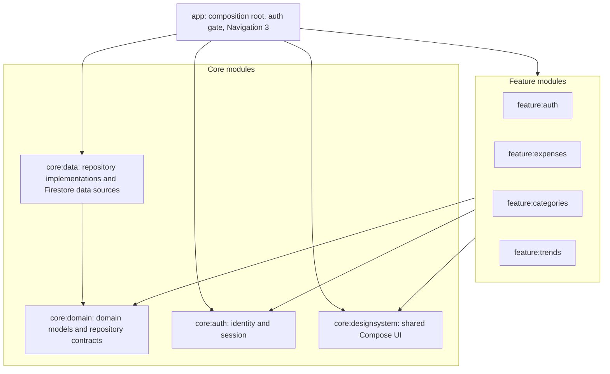

# Piggy architecture guide for AI-assisted changes

This is the project-specific source of truth for architecture guidance. It describes the architecture that exists in this repository; it is not a claim that every Android app should use this structure.

## Current shape

Piggy uses a layered Android app with a Clean Architecture-style dependency inversion boundary for repository contracts:

Arrows show compile-time dependencies. Dependency injection binds the `core:domain` repository interfaces to implementations in `core:data` at the application composition root. In terminology used by Android's architecture guidance, repositories are data-layer entry points; this project places their **contracts** in `core:domain` and their **implementations** in `core:data` so the domain contract does not depend on Firestore. Keep that distinction explicit when changing code or describing the design.

### Module ownership

| Module | Owns |
| --- | --- |
| `app` | Application startup, authentication gate, dependency composition, top-level destinations, and centralized Navigation 3 graph |
| `core:domain` | Firebase-free business models and repository interfaces |
| `core:data` | Repository implementations, remote data sources, Firestore document shapes, Firestore SDK interaction, and persistence mapping |
| `core:auth` | Authentication integration and the user/session abstractions shared by the app |
| `core:designsystem` | Shared theme and reusable visual components |
| `feature:auth`, `feature:expenses`, `feature:categories`, `feature:trends` | Feature UI, screen state/ViewModels, and feature-specific use cases and presentation/domain calculations |
| `build-logic` | Shared Gradle conventions for Android application/library/Compose modules |

Feature `domain` packages are feature-owned use cases and calculations. They are not a second copy of `core:domain`, and they must not contain Firebase persistence code.

## Dependency and layering rules

- `core:domain` must not depend on Android UI, Firebase, Firestore, or feature modules. Keep its models and contracts usable without knowing the persistence technology.
- `core:data` implements `core:domain` contracts. It may depend on Firebase/Firestore and performs source-specific queries, persistence mapping, and coordination of data sources.
- Feature code requests application data through repository contracts, directly or through a feature-owned use case. ViewModels and composables must not access Firestore or data sources directly.
- Add a use case when it represents meaningful feature behavior, combines operations, or keeps a ViewModel/screen state holder focused. Do not add a one-line wrapper mechanically when it adds no useful boundary; follow nearby feature conventions and keep behavior testable.
- `app` wires modules and navigation. Feature modules do not register themselves through a second navigation framework or depend on the app module.
- Keep the module graph acyclic. A reusable module must not depend on a feature module merely to reuse one feature's implementation; move a stable shared contract or component to the appropriate core module when justified.
- Keep shared SDK, Compose, SDK-level, and JVM build settings in the existing convention plugins. Keep namespace, dependencies, and module-specific plugins in that module's build file.

## Models and mapping

Use separate models when they express different contracts or lifecycle boundaries:

- **Firestore document models** describe stored fields and Firebase-specific value types. Keep them and their serialization annotations internal to `core:data`.
- **Domain models** represent app concepts and must not expose Firestore `Timestamp`, `DocumentSnapshot`, Firebase annotations, or SDK objects.
- **UI state/models** may reshape domain data for one screen. Keep presentation-only formatting or transient state out of persistence models.

Map at the boundary where the representations change, close to the code that owns the source representation. For Firestore reads, map Firestore document data to domain models inside the data layer/data source or a small data-layer mapper. For writes, map domain inputs to Firestore fields there as well. Keep mapping functions deterministic and easy to test; handle missing or malformed stored fields deliberately rather than leaking nullable persistence types into domain models.

Do not introduce a mapper class or a duplicate model solely for naming symmetry. Reuse a model when it already has the same meaning, ownership, and validity rules. When creating a separate model, make the reason clear in its name and keep conversion in one directionally obvious place. Do not make a mapper reach across layers to query repositories or perform I/O.

## Persistence and state flow

- Firestore is the current remote persistence implementation. There is no Room database or app-owned local synchronization layer. Do not add either without an explicit product decision.
- Keep source-specific query details and SDK errors in `core:data`; expose application-level values and failures across repository contracts.
- Expose observable application data with `Flow` where ongoing updates are needed and use suspend functions for one-shot operations, consistent with existing contracts.
- Preserve cancellation: rethrow `CancellationException` rather than converting it into a normal error result.

## Navigation and UI

- The top-level Navigation 3 back stack and destination dispatch remain centralized in `app/navigation` at the current project scale.
- Feature screens should receive state and callbacks; screen-level ViewModels own feature presentation state. Shared visual components belong in `core:designsystem` when there is genuine reuse.
- Preserve unidirectional state flow: UI actions call state-holder methods, and UI renders observable state. Do not store an `Activity`, `Context`, or `Resources` in a ViewModel unless a narrowly justified Android API requires it.

## Change workflow

1. Inspect the target module's `build.gradle.kts`, nearby implementations, and the relevant `core:domain` contracts before moving code.
2. Identify which layer owns the behavior and which model is authoritative at each boundary. Follow the existing dependency direction; do not fix a local problem by making a lower layer depend on a feature or UI module.
3. Change only the necessary contracts, implementations, mappings, bindings, and callers. Update module dependencies when ownership changes.
4. Add or update focused tests for changed mapping and behavior when appropriate to the requested change and repository conventions. Keep tests independent of Firestore when testing pure mapping or business behavior.
5. Validate with the narrowest useful Gradle compile/test task, then broader tasks when the change warrants it. Do not claim tests passed unless they were run.
6. Update this guide when an intentional architecture decision changes these boundaries.

## Decision references

Android's official architecture recommendations are guidance, not an inflexible mandate. Piggy's explicit choice is to keep domain contracts independent of Firestore while implementations remain in the data module. Preserve this choice unless the user explicitly changes it. See [Android architecture recommendations](https://developer.android.com/topic/architecture/recommendations) and [data layer guidance](https://developer.android.com/topic/architecture/data-layer).

## AI tool entry points

Keep architecture policy in this guide and avoid maintaining separate versions for each assistant. The short root `AGENTS.md` is the shared entry point for Codex, Antigravity, and Gemini in Android Studio. `.github/copilot-instructions.md` is a small GitHub Copilot adapter that points to the same policy. The on-demand `.agents/skills/piggy-architecture/SKILL.md` packages the repeatable architecture workflow in the open Agent Skills format; assistants without automatic skill discovery can still follow it by reading the linked file.

This layout uses each tool's integration point without making a vendor-specific file the canonical architecture specification. Tool support and auto-discovery can vary by product surface and settings, so the linked Markdown guide remains readable and usable directly.

- [Gemini in Android Studio: customize with AGENTS.md](https://developer.android.com/studio/gemini/agent-files)
- [Antigravity rules](https://antigravity.google/docs/rules/)
- [GitHub Copilot repository custom instructions](https://docs.github.com/en/copilot/how-tos/copilot-on-github/customize-copilot/add-custom-instructions/add-repository-instructions)
- [Agent Skills overview](https://agentskills.io/home)
